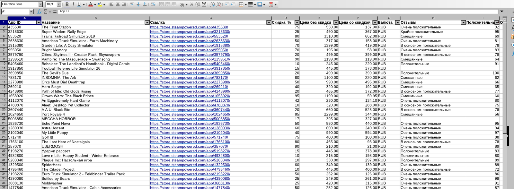
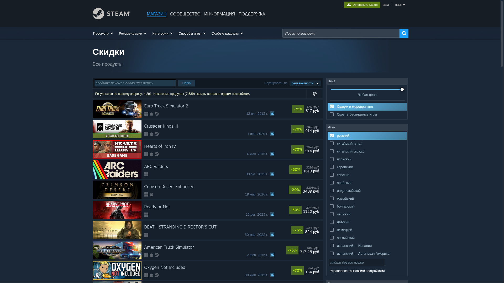

# UltimateWebParser

UltimateWebParser scrapes sites on a schedule with a real Chromium and sends the
result to Telegram as a LibreOffice Calc `.ods` report. It runs on your own
machine under Docker; a Telegram bot is the entire interface.

It is built for one operator — you — keeping an eye on a handful of sites:
prices, discounts, listings that need a login. The browser can hold a persistent
profile, go out through a proxy you pay for, and hand back a report that opens in
Calc without cleaning up first.

## Quick start

Docker with Compose v2 is the only requirement.

```bash
git clone https://github.com/danilruntime/UltimateWebParser && cd UltimateWebParser
cp .env.example .env
$EDITOR .env          # fill in UWP_BOT_TOKEN and UWP_ADMIN_IDS
docker compose -f compose.split.yaml -f compose.split.hostnet.yaml up -d --build
```

When the build finishes and both containers are up, send `/start` to your bot.
The database is created and a disabled example site is seeded — «Steam — deals»
on an `en` deployment, «Steam — скидки» on a `ru` one; press «🟢 Enable» on its
card and the first run is queued at once, and the report arrives in the chat.

[](https://github.com/danilruntime/UltimateWebParser/actions/workflows/tests.yml)
[](LICENSE)
[](pyproject.toml)

> **Status: 0.1 beta.** The service runs end to end and has been measured
> against a live Steam deployment, but the API and the database schema may still
> change between beta releases. Migrations are append-only, so an upgrade never
> loses rows; a downgrade is not supported. Known limitations are in
> [`docs/releases/v0.1b3.md`](docs/releases/v0.1b3.md).

**Русская версия:** [`README.ru.md`](README.ru.md).

**Why two compose files.** `compose.split.yaml` is the bot and the worker;
`compose.split.hostnet.yaml` puts the bot on the host network so it can reach a
Telegram proxy listening on `127.0.0.1`. No such proxy? Drop the second file:
`docker compose -f compose.split.yaml up -d --build`. A single container is
`docker compose up -d --build`; the trade-offs are in
[How it works](#how-it-works).

## Why this instead of cron and a Playwright script

A cron entry, a Playwright script and a CSV exporter get you a file. This is the
rest of what such a script turns into once you need it every day:

- **A scheduler** that spreads each site's runs randomly inside its interval
  (`45-90` minutes, for example) and produces exactly one catch-up run after
  downtime, not a backlog.
- **A report writer**: `.ods` with an autofilter, clickable links, highlighted
  changed rows and a «New» column, without a `soffice` process.
- **A proxy per site**, password included, encrypted in the database with a key
  stretched by PBKDF2 and injected through a loopback bridge — Chromium cannot
  send `Proxy-Authorization` inside a `CONNECT` tunnel.
- **Persistent profiles** with a manual login over VNC: log in by hand once and
  the session cookies are still valid on the next run. Disposable profiles get a
  random fingerprint and clean cookies instead.
- **Change detection** keyed on `external_key`: "new" means new since the last
  run, and a row that vanished and came back counts as new again.
- **A UI**: the bot lists sites, edits the interval, re-runs from history, tests a
  proxy and sends the report file.

The price is the same list read the other way: one deployment per machine (every
stack owns the same 6000–6100 band), Docker, a host that stays on, a single
SQLite file with no replication, and a parser module per site rather than a
selector in a config file.

## When this is not for you

- **A SaaS scraper.** There is no hosted endpoint, no dashboard and no accounts:
  one machine, one SQLite file, one admin allowlist.
- **A CAPTCHA bypass.** A captcha or a region block fails the run as `blocked`.
  You answer it with a proxy or a profile, not with a solver.
- **A distributed cluster.** There is no coordination beyond one SQLite file:
  workers on two machines cannot share the profile folders or the VNC port band,
  and the scheduler has no leader election. One deployment per machine is the
  design, not a missing feature.
- **Scraping a site that forbids it.** Whether the terms allow what you collect
  is your call and your responsibility.

## What it does

- **Parsers are plugins.** A new site is one folder with one class; the bot
  picks it up on restart.
- **Browser profiles.** Disposable (random fingerprint, clean cookies) or
  persistent — for sites that need a login, kept between runs.
- **A proxy per site.** `http`, `https`, `socks5`; passwords are encrypted in
  the database.
- **Manual login over VNC.** A browser on a virtual display; the link and
  password arrive in chat. Log in by hand once — the profile works on its own
  afterwards.
- **A bot with buttons, in Russian or English.** Sites, schedule, profiles,
  proxies, run history.
- **`.ods` reports** with autofilters, clickable links, highlighted changed rows
  and a «New» column.



*A report as Calc opens it: 50 rows, an autofilter on the header, links that
resolve to the store page, numbers formatted, no truncated cells.*



*Manual login over VNC: one kiosk window with the site, no tabs, no desktop
panel and no DevTools, behind noVNC with the sandbox enabled. This is what the
link in chat opens.*

## How it works

One image, two processes. `bot` polls Telegram and owns every message; `worker`
owns Chromium, the VNC stack and the reports. They share `./data` — SQLite in WAL
mode with append-only migrations. The split keeps the bot token out of the
process that runs a browser, and a bot restart does not interrupt a run.

|  | Split (recommended) | Combined |
| --- | --- | --- |
| Files | `compose.split.yaml` + `compose.split.hostnet.yaml` | `compose.yaml` |
| Containers | `uwp-bot`, `uwp-worker` | `uwp` |
| Proxy on `127.0.0.1` | yes, via the hostnet overlay | only with `compose.hostnet.yaml` |
| Restarting the bot | does not interrupt runs | interrupts them |
| Bot token in the worker | no | yes (single process) |

A bare `docker compose up` brings up combined mode: it has a single file, which
is why it stays Compose's default. Split needs explicit `-f`, but it survives a
bot restart and keeps the token out of the process that runs the browser. Only
the bot gets the host network: a worker there would have `websockify` fight
`docker-proxy` for the VNC band and fail with `Address already in use` while the
session still looks started.

In split mode everything that touches processes happens in the worker, on its
next 5-second tick: «🖥 Log in to profile» writes a request row and the worker
brings up Xvfb and Chromium; `uwp vnc stop` only marks a session and the worker
kills it. Reports reach Telegram only through the bot, because a worker that
drained the notification queue would claim every event and send nothing.

Two first-run snags — [permissions on `./data`](docs/README.md#permissions-on-data)
and [finding your Telegram id](docs/README.md#how-to-find-your-telegram-id) — plus
maintenance commands, the troubleshooting table, the CLI, writing a parser and
the release routine are in [`docs/README.md`](docs/README.md).

## The bot

Every screen exists in Russian and English. An admin picks the language with
`/language`, with the «🌐 Language» reply button, or from the «🌐 Language» entry
in the inline menu; the choice is stored in `admins.language` and takes effect on
the next tap. With no choice stored, a screen follows the Telegram client's
`language_code`, then `UWP_DEFAULT_LANGUAGE`; a delivered report has no client
update to read, so it falls back from the stored choice straight to
`UWP_DEFAULT_LANGUAGE`. Each message and screen is rendered for its recipient,
but the report itself is one file, written in the deployment's report language
(`UWP_REPORT_LANGUAGE`, or `UWP_DEFAULT_LANGUAGE` when that is empty).

The reply keyboard has five buttons: «🌐 Sites», «👤 Profiles», «🌍 Proxies»,
«❓ Help», «🌐 Language».

- **🌐 Sites** — the list, plus «➕ Add site»; adding asks for a name
  («✅ Keep “Steam — deals”» keeps the parser's own), and «✏️ Name» on the
  site's settings renames it later. Each card carries
  «🟢 Enable» / «🔴 Disable», «▶️ Run now», «⚙️ Settings», «📜 History» and
  «🗑 Delete»; a site with a profile also has «🖥 Log in to profile».
- **⚙️ Settings** — interval (`45-90`), profile, proxy, report mode, parser
  settings.
- **📜 History** — the site's recent runs, with «🔁 Retry» to queue it again.
- **👤 Profiles** — create a persistent profile and open VNC.
- **🌍 Proxies** — add one and press «🔌 Test».

The interval is in minutes: `60` is every 60 minutes, `45-90` is random within
that range. A manual run does not shift the schedule: it joins the queue with
priority and leaves the next scheduled run where it was.

Chat commands: `/start`, `/help`, `/id`, `/sites`, `/runs`, `/language`.

## Manual login over VNC

A site with a login uses a persistent profile. In the bot: «👤 Profiles» → a
profile → «🖥 Log in», or a site card → «🖥 Log in to profile» (the browser then
opens the site's page and takes its proxy). The link and the password arrive as
a message; log in, then press «✅ Done» and the profile is released.

A session lives 60 minutes (the «⏱ +30 min» button extends it) and, once a
client has connected, closes 20 minutes after the last one disconnects. Ports
6000–6100 are published on the host's `127.0.0.1` only, because noVNC speaks
plain HTTP; from another machine use an SSH tunnel or a TLS reverse proxy. Port
6000 is never handed out — browsers treat it as unsafe (it is the X11 port) — so
the first session gets 6001.

The link opens a kiosk, not a desktop: one full-screen window with the site, no
tab strip, no location bar, no desktop panel or menu, and no DevTools. Reload
(`F5`, `Ctrl+R`) and history (`Alt+←`) still work, so a redirect after login can
be retried; everything else is taken by the window manager before the browser
sees it. This is a UI boundary, not a sandbox: the visitor still types into the
page, and the worker's own secrets stay out of the browser environment.

The CLI path, remote access and the small print are in
[`docs/README.md#vnc-sessions-in-detail`](docs/README.md#vnc-sessions-in-detail).

## Reports

After a run the worker writes an `.ods` into `data/exports/<site-slug>/` and the
bot sends it to the admins. The name follows
`{parser_title}_{site_name}_{YYYY-MM-DD_HH-MM}.ods` with the substituted values
slugified (change the template with `UWP_REPORT_NAME_TEMPLATE`); the last 50
files per site are kept, as are the last 20 artifact directories.

The mode is per site: `always` writes after every run (the default), `changes`
only when there are new or changed rows, `never` writes nothing. The file always
holds the full snapshot with the «New» column and the changed rows highlighted —
the mode decides whether to write, not what to write. «New» means "was not in the
previous run": a row that vanished and returned is new again, and the «Vanished»
count in the metadata sheet says how many rows were missing from this run.

Downloading by hand, retention details and the failure messages are in
[`docs/README.md#report-files`](docs/README.md#report-files).

## Configuration

Two variables are required: the token and the admins.

| Variable | Default | Purpose |
| --- | --- | --- |
| `UWP_BOT_TOKEN` | — | From @BotFather. Required by the bot process only; split mode blanks it in the worker. |
| `UWP_ADMIN_IDS` | empty | Comma-separated Telegram ids (`111,222`); the bot admits the union of these and the `admins` table. |
| `UWP_DATA_DIR` | `data` (`/data` in the image) | Database, profiles, reports, artifacts. The compose files point it at the mounted volume. |
| `UWP_SECRET_KEY` | — | Encrypts proxy and VNC passwords with a PBKDF2-stretched key. Without it they are stored in plaintext (the doctor warns). |
| `UWP_TELEGRAM_PROXY` | — | Proxy for the Bot API **only**: `socks5://`, `socks4://`, `http://`, `https://`. |
| `UWP_DEFAULT_LANGUAGE` | `ru` | `ru` or `en`: the CLI, the bot's fallback and, unless overridden, the report language. |
| `UWP_REPORT_LANGUAGE` | empty | Language of the `.ods`. The worker writes the file with no admin context, so this is deployment-wide; empty means `UWP_DEFAULT_LANGUAGE`. |
| `UWP_DROP_PENDING_UPDATES` | `true` | Discard commands sent while the bot was down. `false` delivers the backlog on the next start, stale button presses included. |
| `UWP_ORPHAN_THRESHOLD` | `90` | Seconds without a heartbeat after which a running job is considered abandoned, requeued and its profile released. |
| `UWP_TZ` | `Europe/Moscow` | Timezone for dates in the bot and in reports. |
| `UWP_PUBLIC_HOST` | `localhost` | The host you open noVNC on. |
| `UWP_PUBLIC_SCHEME` | `http` | `https` if a TLS reverse proxy fronts VNC. |

The full list — timeouts, retention, VNC ports, the browser build — is in
[`.env.example`](.env.example), with a comment above each entry.

## Security

- **VNC ports are loopback-only.** noVNC speaks HTTP with an 8-character
  password and is not exposed outward. Remote access means an SSH tunnel or a
  TLS reverse proxy.
- **Chromium sandbox.** The compose files mount `docker/seccomp-uwp.json`, a
  Docker profile with three relaxations without which Chromium cannot build its
  sandbox from namespaces. What exactly is relaxed and why is in
  `docker/README-seccomp.md`. A bare `docker run` needs
  `--security-opt seccomp=./docker/seccomp-uwp.json`, or the browser refuses to
  start. `UWP_NO_SANDBOX=true` is an emergency hatch: the renderer then shares
  the container's namespaces and can see `/data` — profiles with live cookies and
  the database.
- **The process environment is hidden.** The CLI sets `PR_SET_DUMPABLE=0`, so
  `/proc/<pid>/environ` cannot be read even by processes of the same uid; the
  browser environment is an allowlist. Without both, the VNC browser (same uid
  1000) could read `UWP_BOT_TOKEN` and `UWP_SECRET_KEY`.
- **The token belongs to the bot only.** In split mode `UWP_BOT_TOKEN` is
  deliberately empty in the worker: only `bot` polls Telegram.
- **Admins.** The gate sits at the update level: the bot ignores everyone not in
  `UWP_ADMIN_IDS`/`admins` and answers with one refusal to any update type. The
  bot token is as much a secret as a password.
- **The encryption key.** Set `UWP_SECRET_KEY` before adding proxies; changing
  it makes the old passwords unreadable. It is stretched with
  PBKDF2-HMAC-SHA256 (480,000 iterations), so a leaked database is not a fast
  offline oracle, but a weak key is still guessable.
- **Files.** `data` is created with mode `0700`, the database with `0600`, and
  processes run with `umask 077`: profiles with live cookies, the WAL and VNC
  passwords are not readable by other users of the host. The VNC password is
  wiped when the session stops, and its row is deleted after
  `UWP_VNC_HISTORY_DAYS` (7 days).
- **Cleanup.** The worker runs housekeeping on its first tick and then every
  hour: it deletes expired disposable profiles, finished VNC rows older than
  `UWP_VNC_HISTORY_DAYS` and excess `data/artifacts` directories. Reports beyond
  the last 50 per site are trimmed on every write. What each pass touches is in
  [`docs/README.md#what-the-worker-cleans-up`](docs/README.md#what-the-worker-cleans-up).
- **The proxy bridge.** Chromium cannot send `Proxy-Authorization` in a
  `CONNECT` tunnel, so a bridge on `127.0.0.1` adds the password. It does not
  authenticate its client (Chromium could not present a password), so it refuses
  internal addresses — loopback, RFC 1918, link-local (including
  `169.254.169.254`), `*.internal`/`*.local` — and cannot become a path to the
  Docker socket or cloud metadata.
- **Reports.** Values from HTML end up in the `.ods`; only `http(s)` links become
  clickable, while `javascript:`/`file:`/`data:` stay text. The file name
  template is sanitised, so `../` cannot write outside `data/exports`.

What is deliberately **not** protected, and from whom — the threat model and the
known limitations (the 8-character RFB password, noVNC over HTTP, unencrypted
profiles) — is in [`SECURITY.md`](SECURITY.md).

## Development

```bash
python -m venv .venv && . .venv/bin/activate
pip install -e ".[dev]"
uwp browser install                       # fingerprint-chromium into data/browser
export UWP_BROWSER_PATH="$PWD/data/browser/chrome"   # install prints this line
uwp doctor
uwp init && uwp run                       # bot + worker in one process
```

Python 3.12 or newer. Tests need neither network nor browser:

```bash
pytest                                                    # offline suite; gated ones skip
UWP_LIVE=1 pytest -m live                                 # live Steam page
UWP_TEST_BROWSER=/path/to/chrome pytest -m integration    # a real browser run
ruff check src tests
```

`ruff format` is not used in this project — only `ruff check`.

## License

MIT — the full text is in [`LICENSE`](LICENSE). This covers the code of this
project.

Two included files are not ours and are not covered by MIT:
`docker/seccomp-uwp.json` is a derivative of Docker's profile (Apache-2.0,
modified), and the fixtures `tests/fixtures/steam_search*.html` are Steam
markup (Valve Corporation, no licence granted, used as test data). What else is
installed at build time and under which licences is in
[`THIRD_PARTY_NOTICES.md`](THIRD_PARTY_NOTICES.md), along with the full Apache-2.0
text.
