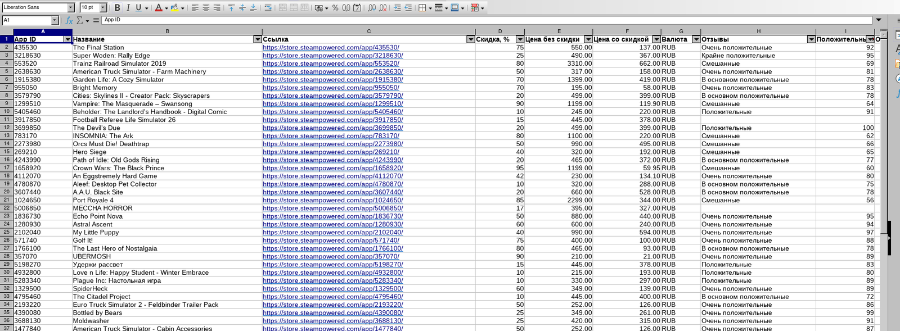
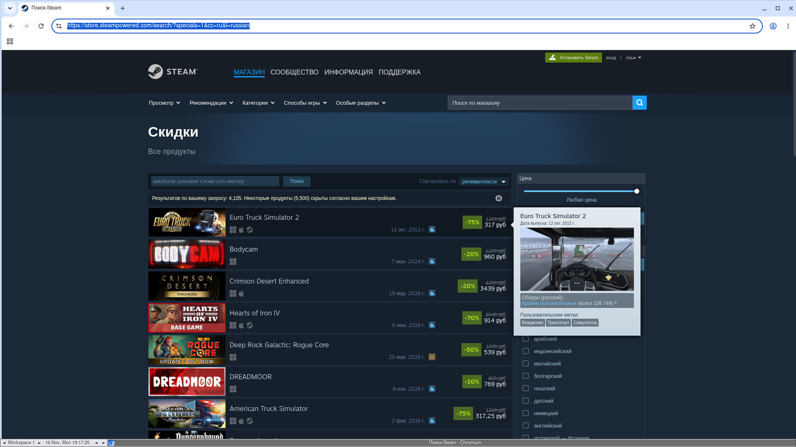

# UltimateWebParser

UltimateWebParser собирает данные с сайтов по расписанию через настоящий Chromium и
присылает результат в Telegram файлом LibreOffice Calc (`.ods`). Работает на
вашей машине в Docker, а весь интерфейс — это Telegram-бот.

Сервис рассчитан на одного человека — на вас, — который следит за несколькими
сайтами: цены, скидки, объявления, для которых нужен вход. Браузер умеет держать
постоянный профиль, ходить через оплаченный прокси и отдавать отчёт, который
открывается в Calc без ручной чистки.

## Быстрый старт

Нужен только Docker с Compose v2.

```bash
git clone https://github.com/danilruntime/UltimateWebParser && cd UltimateWebParser
cp .env.example .env
$EDITOR .env          # вписать UWP_BOT_TOKEN и UWP_ADMIN_IDS
docker compose -f compose.split.yaml -f compose.split.hostnet.yaml up -d --build
```

Когда сборка закончится и оба контейнера поднимутся, напишите своему боту
`/start`. База создастся, в ней появится выключенный пример сайта — «Steam —
скидки» на `ru`-развёртывании и «Steam — deals» на `en`; нажмите на его карточке
«🟢 Включить» — первый прогон встанет в очередь сразу, и отчёт придёт в чат.

[](https://github.com/danilruntime/UltimateWebParser/actions/workflows/tests.yml)
[](LICENSE)
[](pyproject.toml)

> **Статус: 0.1 beta.** Сервис работает целиком и проверен на живом развёртывании
> со Steam, но API и схема базы ещё могут меняться между бета-выпусками.
> Миграции только добавляются, поэтому обновление не теряет строк; откат на
> предыдущую версию не поддерживается. Известные ограничения —
> в [`docs/releases/v0.1b3.md`](docs/releases/v0.1b3.md).

**English version:** [`README.md`](README.md).

**Зачем два файла compose.** `compose.split.yaml` — это бот и воркер;
`compose.split.hostnet.yaml` переводит бота в сеть хоста, чтобы он достал до
прокси Telegram на `127.0.0.1`. Такого прокси нет? Второй файл не нужен:
`docker compose -f compose.split.yaml up -d --build`. Один контейнер — это
`docker compose up -d --build`; чем режимы различаются, написано в разделе
[Как это устроено](#как-это-устроено).

## Чем это лучше cron и скрипта на Playwright

Запись в cron, скрипт на Playwright и выгрузка в CSV дают файл. А дальше
начинается то, во что такой скрипт превращается, когда он нужен каждый день:

- **Планировщик**, который распределяет прогоны внутри интервала случайно
  (`45-90` минут, например) и после простоя делает ровно один догоняющий
  прогон, а не очередь накопившихся.
- **Запись отчёта**: `.ods` с автофильтром, кликабельными ссылками, подсветкой
  изменившихся строк и колонкой «Новое» — без запуска `soffice`.
- **Прокси на каждый сайт**, вместе с паролем. Пароль шифруется в базе ключом,
  растянутым через PBKDF2, и подставляется через локальный мост — Chromium не
  умеет отправлять `Proxy-Authorization` внутри `CONNECT`-туннеля.
- **Постоянные профили** с ручным входом через VNC: достаточно один раз войти
  руками — и cookie профиля действуют в следующем прогоне. Одноразовые профили
  вместо этого получают случайный отпечаток и чистые cookie.
- **Определение изменений** по `external_key`: «новое» значит «не было в прошлом
  прогоне», а строка, которая пропала и вернулась, снова считается новой.
- **Интерфейс**: бот показывает сайты, меняет интервал, повторяет прогон из
  истории, проверяет прокси и присылает файл отчёта.

Цена — тот же список с обратной стороны: одно развёртывание на машину (каждый
стек занимает одну и ту же полосу 6000–6100), Docker, включённый хост, один файл
SQLite без репликации и модуль парсера на каждый сайт вместо селектора в конфиге.

## Когда это не нужно

- **SaaS-скрапер.** Здесь нет ни готового сервиса, ни панели, ни аккаунтов: одна
  машина, один файл SQLite, один список админов.
- **Обход капчи.** Капча или блок региона помечает прогон как `blocked`.
  С этим помогают справиться прокси или постоянный профиль, а не решатель капчи.
- **Распределённый кластер.** Координации сверх одного файла SQLite нет: воркеры
  на двух машинах не разделят ни каталоги профилей, ни полосу портов VNC, а у
  планировщика нет выбора лидера. Одно развёртывание на машину — это решение, а не
  недостающая функция.
- **Сбор с сайта, который это запрещает.** Разрешают ли условия сайта то, что вы
  собираете, — ваш вопрос и ваша ответственность.

## Что умеет

- **Парсеры как плагины.** Новый сайт — папка с одним классом; бот подхватывает
  его при перезапуске.
- **Профили браузера.** Одноразовый (случайный отпечаток, чистые cookie) или
  постоянный — для сайтов со входом, живёт между прогонами.
- **Прокси на каждый сайт.** `http`, `https`, `socks5`; пароли шифруются в базе.
- **Ручной вход через VNC.** Браузер на виртуальном экране, ссылка и пароль
  приходят в чат. Нужно один раз войти на сайт руками — дальше профиль работает
  сам.
- **Бот с кнопками, на русском или английском.** Сайты, расписание, профили,
  прокси, история прогонов.
- **Отчёты `.ods`** с фильтрами, кликабельными ссылками, подсветкой изменённых
  строк и колонкой «Новое».



*Отчёт так, как его открывает Calc: 50 строк, автофильтр в шапке, ссылки ведут
на страницу магазина, числа отформатированы, обрезанных ячеек нет.*



*Ручной вход через VNC: одно окно-киоск, без вкладок, панели и DevTools, за
noVNC, песочница включена. Ссылка из чата открывает этот киоск и загружает
страницу, которую парсер объявляет для входа; на снимке тот же киоск на странице
скидок Steam.*

## Как это устроено

Один образ, два процесса. `bot` опрашивает Telegram и отвечает за все сообщения;
`worker` владеет Chromium, VNC-стеком и отчётами. Оба смотрят в общий `./data` —
SQLite в режиме WAL с миграциями, которые только добавляются. Разделение
оставляет токен бота вне процесса, который запускает браузер, а перезапуск бота
не прерывает прогон.

|  | Split (рекомендуется) | Combined |
| --- | --- | --- |
| Файлы | `compose.split.yaml` + `compose.split.hostnet.yaml` | `compose.yaml` |
| Контейнеры | `uwp-bot`, `uwp-worker` | `uwp` |
| Прокси на `127.0.0.1` | да, через hostnet-overlay | только с `compose.hostnet.yaml` |
| Перезапуск бота | не прерывает прогоны | прерывает |
| Токен бота в воркере | нет | да (один процесс) |

Один `docker compose up` поднимает combined: у него один файл, поэтому он и
остаётся умолчанием Compose. Split требует явных `-f`, зато переживает
перезапуск бота и не держит токен там, где работает браузер. В сеть хоста уходит
только бот: воркер там начнёт драться с `docker-proxy` за полосу VNC и упадёт с
`Address already in use`, хотя сессия будет выглядеть запущенной.

В split-режиме всё, что связано с процессами, делает воркер — на ближайшем
тике, который случается раз в 5 секунд: «🖥 Войти в профиль» пишет заявку в
базу, а Xvfb и Chromium поднимает воркер; `uwp vnc stop` только помечает сессию,
а процессы убивает он же. Отчёты в Telegram отправляет только бот: воркер,
который забрал бы очередь уведомлений, пометил бы все события доставленными и не
отправил ничего.

Две первые помехи — [права на `./data`](docs/README.ru.md#permissions-on-data) и
[как узнать свой Telegram id](docs/README.ru.md#how-to-find-your-telegram-id) —
вместе с командами обслуживания, таблицей неполадок, CLI, написанием парсера и
выпуском релиза живут в [`docs/README.ru.md`](docs/README.ru.md).

## Бот

Каждый экран есть на русском и английском. Админ выбирает язык через `/language`,
кнопкой «🌐 Язык» на клавиатуре или пунктом «🌐 Язык» в inline-меню; выбор
хранится в `admins.language` и действует со следующего нажатия. Если выбора нет,
экран берёт `language_code` клиента Telegram, а затем `UWP_DEFAULT_LANGUAGE`; у
доставленного отчёта клиентского апдейта нет, поэтому он переходит с
сохранённого выбора сразу на `UWP_DEFAULT_LANGUAGE`. Каждое сообщение и экран
рендерятся для своего получателя, а отчёт — один файл на языке отчётов
развёртывания (`UWP_REPORT_LANGUAGE`, а если пусто — `UWP_DEFAULT_LANGUAGE`).

На постоянной клавиатуре пять кнопок: «🌐 Сайты», «👤 Профили», «🌍 Прокси»,
«❓ Помощь», «🌐 Язык».

- **🌐 Сайты** — список и «➕ Добавить сайт»; при добавлении бот спрашивает
  название («✅ Оставить «Steam — скидки»» — имя парсера), а «✏️ Название» в
  настройках сайта переименовывает его позже. На карточке сайта «🟢 Включить» /
  «🔴 Выключить», «▶️ Запустить сейчас», «⚙️ Настройки», «📜 История» и
  «🗑 Удалить»; у сайта с профилем есть ещё «🖥 Войти в профиль».
- **⚙️ Настройки** — интервал (`45-90`), профиль, прокси, режим отчёта, параметры
  парсера.
- **📜 История** — последние прогоны сайта и «🔁 Повторить», чтобы поставить его
  в очередь снова.
- **👤 Профили** — создать постоянный профиль и открыть VNC.
- **🌍 Прокси** — добавить и нажать «🔌 Проверить».

Интервал задаётся в минутах: `60` — каждые 60 минут, `45-90` — случайно в этом
диапазоне. Ручной запуск не сдвигает расписание: он встаёт в очередь с
приоритетом, а ближайший плановый прогон остаётся там, где был.

Команды в чате: `/start`, `/help`, `/id`, `/sites`, `/runs`, `/language`.

## Ручной вход через VNC

Сайт со входом использует постоянный профиль. Сначала привяжите профиль к сайту
в настройках сайта: тогда вход откроет страницу входа, которую парсер объявляет
как `auth_url` (или его страницу прогона, если отдельной нет), и возьмёт прокси
сайта, а если у сайта его нет — прокси профиля. Запустить его можно с карточки
сайта («🖥 Войти в профиль») или из «👤 Профили» → профиль → «🖥 Войти». Профиль,
не привязанный ни к одному сайту, получает отказ с подсказкой; привязанный к
нескольким сайтам — тоже: у них могут быть разные прокси, поэтому начните вход с
карточки нужного сайта. Ссылка и пароль приходят сообщением; войдите на сайт и
нажмите «✅ Готово» — профиль освободится.

Сессия живёт 60 минут (кнопка «⏱ +30 мин» продлевает), а если клиент
подключался — закрывается через 20 минут после отключения последнего. Порты
6000–6100 опубликованы только на `127.0.0.1` хоста, потому что noVNC говорит по
открытому HTTP; с другой машины нужен SSH-туннель или TLS reverse proxy. Порт
6000 не выдаётся никогда — браузеры считают его небезопасным (это порт X11), —
поэтому первая сессия получает 6001.

Ссылка открывает киоск, а не рабочий стол: одно окно на весь экран с сайтом,
без вкладок, адресной строки, панели и меню рабочего стола и без DevTools.
Перезагрузка (`F5`, `Ctrl+R`) и история (`Alt+←`) работают, чтобы можно было
переиграть редирект после входа; всё остальное перехватывает оконный менеджер
раньше, чем браузер. Это граница интерфейса, а не песочница: страница
по-прежнему принимает ввод, а секреты воркера в окружение браузера не попадают.

Скачивание файла в этом окне отклоняется до записи на диск: киоск никогда не
показывает диалог «Сохранить как», а в профиле нет и каталога, куда файл мог бы
лечь. Окно входа — для входа; страница не должна заполнять диск хоста, где лежит
база.

Путь через CLI, доступ с другой машины и мелочи — в
[`docs/README.ru.md#vnc-sessions-in-detail`](docs/README.ru.md#vnc-sessions-in-detail).

## Отчёты

После прогона воркер пишет `.ods` в `data/exports/<site-slug>/`, а бот
отправляет файл админам. Имя — `{parser_title}_{site_name}_{ГГГГ-ММ-ДД_ЧЧ-ММ}.ods`;
подставленные значения транслитерируются в slug (шаблон меняется
`UWP_REPORT_NAME_TEMPLATE`). Хранятся последние 50 файлов на сайт и последние
20 каталогов артефактов.

Режим настраивается на сайт: `always` пишет после каждого прогона (по умолчанию),
`changes` — только когда есть новые или изменившиеся строки, `never` — не пишет
ничего. В файл всегда попадает полный срез с колонкой «Новое» и подсветкой
изменившихся строк: режим решает, писать ли файл, а не что в нём. «Новое» — это
«не было в прошлом прогоне»: строка, которая пропала и вернулась, снова новая, а
число «Исчезло» на листе метаданных говорит, сколько строк не встретилось именно
в этом прогоне.

Скачивание вручную, детали хранения и тексты ошибок — в
[`docs/README.ru.md#report-files`](docs/README.ru.md#report-files).

## Настройки

Обязательных переменных две: токен и админы.

| Переменная | По умолчанию | Зачем |
| --- | --- | --- |
| `UWP_BOT_TOKEN` | — | Токен от @BotFather. Нужен только процессу бота; в split-режиме у воркера он пустой. |
| `UWP_ADMIN_IDS` | пусто | Telegram id через запятую (`111,222`); бот пускает объединение этого списка и таблицы `admins`. |
| `UWP_DATA_DIR` | `data` (`/data` в образе) | База, профили, отчёты, артефакты. Compose-файлы указывают на смонтированный том. |
| `UWP_SECRET_KEY` | — | Шифрует пароли прокси и VNC ключом, растянутым через PBKDF2. Без него они лежат открыто (доктор предупредит). |
| `UWP_TELEGRAM_PROXY` | — | Прокси **только** для Bot API: `socks5://`, `socks4://`, `http://`, `https://`. |
| `UWP_DEFAULT_LANGUAGE` | `ru` | `ru` или `en`: CLI, запасной язык бота и, если не задано иное, язык отчётов. |
| `UWP_REPORT_LANGUAGE` | пусто | Язык `.ods`. Отчёт пишет воркер, у которого нет админа, поэтому настройка общая для развёртывания; пусто — значит `UWP_DEFAULT_LANGUAGE`. |
| `UWP_DROP_PENDING_UPDATES` | `true` | Выбрасывать команды, отправленные пока бот лежал. `false` доставит накопленное при следующем старте, вместе с устаревшими нажатиями кнопок. |
| `UWP_ORPHAN_THRESHOLD` | `90` | Секунды без heartbeat, после которых идущий прогон считается брошенным: его возвращают в очередь и освобождают профиль. |
| `UWP_TZ` | `Europe/Moscow` | Часовой пояс дат в боте и отчётах. |
| `UWP_PUBLIC_HOST` | `localhost` | Хост, по которому вы открываете noVNC. |
| `UWP_PUBLIC_SCHEME` | `http` | `https`, если перед VNC стоит TLS reverse proxy. |

Полный список — таймауты, хранение, порты VNC, сборка браузера — в
[`.env.example`](.env.example), с комментарием над каждой переменной.

## Безопасность

- **Порты VNC — только loopback.** noVNC говорит по HTTP с 8-символьным паролем
  и наружу не выставляется. Для удалённого доступа — SSH-туннель или TLS reverse
  proxy.
- **Песочница Chromium.** Compose-файлы подключают `docker/seccomp-uwp.json` —
  профиль Docker с тремя послаблениями, без которых Chromium не может собрать
  песочницу из namespaces. Что именно послаблено и почему — в
  [`docker/README-seccomp.ru.md`](docker/README-seccomp.ru.md). Голому
  `docker run` нужен `--security-opt seccomp=./docker/seccomp-uwp.json`, иначе
  браузер честно откажется стартовать. `UWP_NO_SANDBOX=true` — аварийный выход:
  рендерер оказывается в общих с контейнером namespaces и видит `/data` — профили
  с живыми cookie и базу.
- **Окружение процесса скрыто.** CLI выставляет `PR_SET_DUMPABLE=0`, поэтому
  `/proc/<pid>/environ` не читается даже процессами того же uid; переменные
  браузера идут по allowlist. Без этого VNC-браузер (тот же uid 1000) прочитал бы
  `UWP_BOT_TOKEN` и `UWP_SECRET_KEY`.
- **Токен только у бота.** В split-режиме `UWP_BOT_TOKEN` намеренно пустой у
  воркера: Telegram опрашивает только `bot`.
- **Админы.** Гейт стоит на уровне апдейта: бот игнорирует всех, кого нет в
  `UWP_ADMIN_IDS`/`admins`, и отвечает одним отказом на любой тип апдейта. Токен
  бота — такой же секрет, как пароль.
- **Ключ шифрования.** Задайте `UWP_SECRET_KEY` до добавления прокси: со сменой
  ключа старые пароли станут нечитаемыми. Он растягивается
  PBKDF2-HMAC-SHA256 (480 000 итераций), поэтому утечка базы не даёт быстрого
  перебора, но слабый ключ всё равно перебирается.
- **Файлы.** `data` создаётся с правами `0700`, база — `0600`, процессы работают
  с `umask 077`: профили с живыми cookie, WAL и пароли VNC не читаются другими
  пользователями хоста. Пароль VNC стирается при остановке сессии, а её строка
  удаляется через `UWP_VNC_HISTORY_DAYS` (7 дней).
- **Уборка.** Воркер запускает её на первом же тике, а дальше раз в час: удаляет
  истёкшие одноразовые профили, завершённые строки VNC старше
  `UWP_VNC_HISTORY_DAYS` и лишние каталоги `data/artifacts`. Отчёты сверх
  последних 50 на сайт подрезаются при каждой записи. Что именно делает каждый
  проход — в
  [`docs/README.ru.md`](docs/README.ru.md#what-the-worker-cleans-up).
- **Мост прокси.** Chromium не умеет отправлять `Proxy-Authorization` в
  `CONNECT`-туннель, поэтому пароль добавляет мост на `127.0.0.1`. Клиента он не
  аутентифицирует (Chromium не смог бы предъявить пароль), поэтому отказывается
  открывать внутренние адреса — loopback, RFC 1918, link-local (включая
  `169.254.169.254`), `*.internal`/`*.local` — и не может стать путём к
  Docker-сокету или метаданным облака.
- **Отчёты.** Значения из HTML попадают в `.ods`; кликабельными становятся только
  `http(s)`-ссылки, `javascript:`/`file:`/`data:` остаются текстом. Шаблон имени
  файла санитайзится, поэтому `../` не выведет запись за `data/exports`.

Что **сознательно не защищено** и от кого именно — модель угроз и известные
ограничения (8-символьный пароль RFB, noVNC по HTTP, профили без шифрования) —
в [`SECURITY.ru.md`](SECURITY.ru.md).

## Разработка

```bash
python -m venv .venv && . .venv/bin/activate
pip install -e ".[dev]"
uwp browser install                       # fingerprint-chromium в data/browser
export UWP_BROWSER_PATH="$PWD/data/browser/chrome"   # эту строку печатает install
uwp doctor
uwp init && uwp run                       # бот и воркер в одном процессе
```

Нужен Python 3.12 или новее. Тестам не нужны ни сеть, ни браузер:

```bash
pytest                                                    # офлайн-набор; закрытые — skip
UWP_LIVE=1 pytest -m live                                 # живая страница Steam
UWP_TEST_BROWSER=/path/to/chrome pytest -m integration    # прогон в браузере
ruff check src tests
```

`ruff format` в проекте не используется — только `ruff check`.

## Лицензия

MIT — полный текст в [`LICENSE`](LICENSE). Это касается кода этого проекта.

Четыре вложения написаны не нами и под MIT не попадают:
`docker/seccomp-uwp.json` — производная профиля Docker (Apache-2.0, изменён),
фикстуры `tests/fixtures/steam_search*.html` — разметка Steam (Valve
Corporation, без лицензии, используются как тестовые данные), а
`tests/fixtures/soundcloud_playlist.html` и `soundcloud_tracks.json` — разметка
и данные треков SoundCloud (SoundCloud Limited и авторы треков, без лицензии,
используются как тестовые данные). Что ещё устанавливается при сборке и под
какими лицензиями — в
[`THIRD_PARTY_NOTICES.ru.md`](THIRD_PARTY_NOTICES.ru.md), там же полный текст
Apache-2.0.
